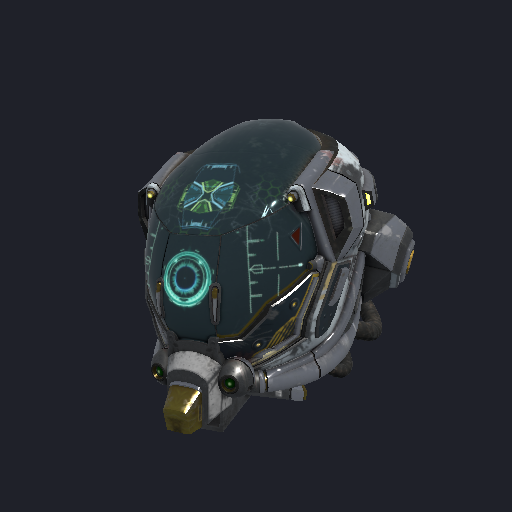
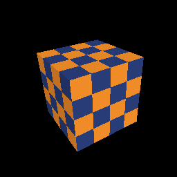

<p align="center">
  
</p>

<h2 align="center">gpu</h2>
<p align="center">GPU compute, rendering, 3D models and machine learning for Eskiu, over WebGPU.</p>
<p align="center"><sub>Part of the <a href="https://github.com/eskiu-lang">Eskiu</a> project</sub></p>
<p align="center">
  <a href="https://eskiu-lang.org">eskiu-lang.org</a> &nbsp;&middot;&nbsp;
  <a href="#modules">Modules</a> &nbsp;&middot;&nbsp;
  <a href="examples/">Examples</a> &nbsp;&middot;&nbsp;
  <a href="https://github.com/eskiu-lang/eskiu">The language</a>
</p>

<p align="center">
  <a href="https://github.com/eskiu-lang/gpu/actions/workflows/ci.yml"></a>
  
  
  <a href="LICENSE"></a>
</p>

---

`gpu` is an Eskiu package for running compute kernels and drawing on the GPU. It is built
on [wgpu-native](https://github.com/gfx-rs/wgpu-native), so one API runs on Metal (macOS
and iOS), Vulkan (Linux and Android) and DirectX 12 (Windows), and shaders are written in
WGSL.

- **Compute.** Storage buffers, kernels and dispatches, with results read back into
  Eskiu memory.
- **Rendering.** Textures, samplers, depth buffers, vertex, index and uniform buffers,
  render pipelines and passes, to an offscreen texture or a window; several render targets,
  stencil, multisampling, cube and array targets, and shadow maps; in the browser too,
  through emdawnwebgpu, with a WebGL2 backend for browsers without WebGPU.
- **3D models.** `<gpu/gltf>` loads glTF 2.0 (`.gltf` and `.glb`), `<gpu/obj>` loads Wavefront
  OBJ with its MTL materials and textures, and `<gpu/model>` draws either with physically
  based shading, normal maps, alpha modes, skinning, morph targets, animation, image-based
  lighting and shadows.
- **Machine learning.** `<gpu/nn>` runs transformer inference (Llama 2 7B at 45 tokens per
  second on an M4 Pro, from GGUF, safetensors or llama2.c files) and `<gpu/train>` trains
  networks with automatic differentiation and Adam.
- **Images.** `<gpu/image>` decodes PNG, JPEG (baseline and progressive) and Radiance `.hdr`
  in pure Eskiu, and `<gpu/ktx2>` reads KTX2 files; textures can be sRGB, mipmapped (on the
  GPU too), layered, cube maps and BC, ETC2 or ASTC compressed.
- **Windows, mobile views and input.** `<gpu/window>` opens a desktop window over SDL3 and
  gives its surface and its keyboard, mouse, gamepad (with rumble) and touch input;
  `<gpu/ui>` mounts a `GpuView` (`CAMetalLayer` on iOS, `SurfaceView` on Android) inside an [`eskiu-lang/ui`](https://github.com/eskiu-lang/ui) app.
- **Errors as `Result`.** Every call that can fail returns one, with the message from the
  WebGPU validation layer; a WGSL error comes with its line and column.
- **The whole API underneath.** `<gpu/raw>` is all of `webgpu.h` and `wgpu.h`, generated,
  with every struct's layout checked against the C compiler.

<p align="center">
  " width="300">
  
</p>
<p align="center"><sub>DamagedHelmet by theblueturtle_ (CC BY 4.0), from the Khronos glTF sample assets.</sub></p>

## Compute

```eskiu
import <io>;
import <gpu>;

string twice = "@group(0) @binding(0) var<storage, read_write> v: array<f32>;\n"
    "@compute @workgroup_size(64)\n"
    "fn main(@builtin(global_invocation_id) id: vec3<u32>) { v[id.x] = v[id.x] * 2.0; }\n";

Result<int, string> run() {
    float[256] data;
    for (i in 0..256) data[i] = (float)i;
    Gpu gpu = gpu_open()?;
    defer gpu.release();
    GpuBuffer v = gpu.storage(&data, sizeof(data))?;
    defer v.release();
    GpuKernel k = gpu.kernel(twice, "main")?;
    defer k.release();
    k.bind(0, &v);
    k.dispatch(4, 1, 1)?;
    v.read(&data, sizeof(data))?;
    printf("%.1f\n", (double)data[255]);
    return Ok<int, string>(0);
}

Result<int, string> r = run();
if (!r.ok) printf("error: %s\n", r.error);
```

```
$ eskiuc run twice.esk
510.0
```

## Documentation

- [Rendering](docs/rendering.md): windows, textures, passes, stencil, multisampling, render targets, cube maps, mipmaps, shadow maps, compressed textures
- [Models](docs/models.md): glTF and OBJ, materials, skinning and animation; [morph targets](docs/morph.md), [image-based lighting](docs/ibl.md), [shadows](docs/shadows.md)
- [Images](docs/image.md): PNG, JPEG, HDR, KTX2, EXIF orientation and limits
- [Camera and video frames](docs/yuv.md): `<gpu/yuv>`, YUV planes to RGB on the GPU
- [Web](docs/web.md): the browser through emdawnwebgpu, and WebGL2 where WebGPU is missing
- [Window input](docs/input.md): keyboard, mouse, gamepads and touch on the desktop
- [iOS and Android](docs/mobile.md): `GpuView`, the frame loop, touches
- [Machine learning](docs/ml.md): `<gpu/nn>` inference and `<gpu/train>`
- [Platforms, modules and contributing](docs/README.md)
- [API reference](docs/api.md): every public function and type

## Install

In an Eskiu package (Eskiu 0.14 or newer, for the iOS and Android archives):

```bash
eskiuc add gpu --git https://github.com/eskiu-lang/gpu --rev v0.5.0
eskiuc build
```

The first build downloads wgpu-native for your platform and checks its SHA-256, and SDL3 for `<gpu/window>` on the desktop. See [installation details](docs/README.md#installation-details).

## License

MIT. See [LICENSE](LICENSE). Third-party code (naga in the WebGL2 backend, SDL3 in the
prebuilt archives) is credited in [THIRD_PARTY_NOTICES.md](THIRD_PARTY_NOTICES.md).
