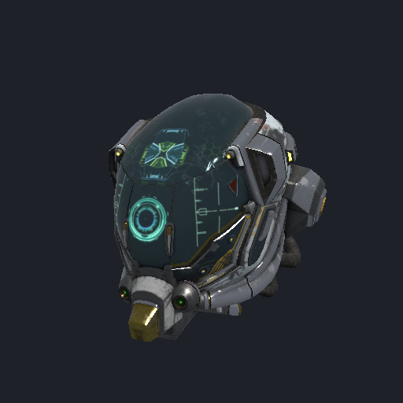
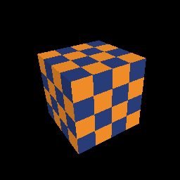

<p align="center">
  
</p>

<h2 align="center">gpu</h2>
<p align="center">GPU compute, rendering, 3D models and machine learning for Eskiu, over WebGPU.</p>
<p align="center"><sub>Part of the <a href="https://github.com/eskiu-lang">Eskiu</a> project</sub></p>
<p align="center">
  <a href="https://eskiu-lang.org">eskiu-lang.org</a> &nbsp;&middot;&nbsp;
  <a href="#modules">Modules</a> &nbsp;&middot;&nbsp;
  <a href="examples/">Examples</a> &nbsp;&middot;&nbsp;
  <a href="https://github.com/eskiu-lang/eskiu">The language</a>
</p>

<p align="center">
  <a href="https://github.com/eskiu-lang/gpu/actions/workflows/ci.yml"></a>
  
  
  <a href="LICENSE"></a>
</p>

---

`gpu` is an Eskiu package for running compute kernels and drawing on the GPU. It is built
on [wgpu-native](https://github.com/gfx-rs/wgpu-native), so one API runs on Metal (macOS
and iOS), Vulkan (Linux and Android) and DirectX 12 (Windows), and shaders are written in
WGSL.

- **Compute.** Storage buffers, kernels and dispatches, with results read back into
  Eskiu memory.
- **Rendering.** Textures, samplers, depth buffers, vertex, index and uniform buffers,
  render pipelines and passes, to an offscreen texture or a window.
- **3D models.** `<gpu/gltf>` loads glTF 2.0 (`.gltf` and `.glb`), `<gpu/obj>` loads Wavefront
  OBJ with its MTL materials and textures, and `<gpu/model>` draws either with physically
  based shading, normal maps, alpha modes, skinning and animation.
- **Machine learning.** `<gpu/nn>` runs transformer inference (Llama 2 7B at 45 tokens per
  second on an M4 Pro, from GGUF, safetensors or llama2.c files) and `<gpu/train>` trains
  networks with automatic differentiation and Adam.
- **Images.** `<gpu/image>` decodes PNG and JPEG (baseline and progressive) in pure Eskiu;
  textures can be sRGB and mipmapped.
- **Windows, mobile views and input.** `<gpu/window>` opens a desktop window over SDL3 and
  gives its surface and keyboard/mouse events; `<gpu/ui>` mounts a `GpuView` (`CAMetalLayer`
  on iOS, `SurfaceView` on Android) inside an [`eskiu-lang/ui`](https://github.com/eskiu-lang/ui) app.
- **Errors as `Result`.** Every call that can fail returns one, with the message from the
  WebGPU validation layer; a WGSL error comes with its line and column.
- **The whole API underneath.** `<gpu/raw>` is all of `webgpu.h` and `wgpu.h`, generated,
  with every struct's layout checked against the C compiler.

<p align="center">
  " width="300">
  
</p>
<p align="center"><sub>DamagedHelmet by theblueturtle_ (CC BY 4.0), from the Khronos glTF sample assets.</sub></p>

## Compute

```eskiu
import <io>;
import <gpu>;

string twice = "@group(0) @binding(0) var<storage, read_write> v: array<f32>;\n"
    "@compute @workgroup_size(64)\n"
    "fn main(@builtin(global_invocation_id) id: vec3<u32>) { v[id.x] = v[id.x] * 2.0; }\n";

Result<int, string> run() {
    float[256] data;
    for (i in 0..256) data[i] = (float)i;
    Gpu gpu = gpu_open()?;
    defer gpu.release();
    GpuBuffer v = gpu.storage(&data, sizeof(data))?;
    defer v.release();
    GpuKernel k = gpu.kernel(twice, "main")?;
    defer k.release();
    k.bind(0, &v);
    k.dispatch(4, 1, 1)?;
    v.read(&data, sizeof(data))?;
    printf("%.1f\n", (double)data[255]);
    return Ok<int, string>(0);
}

Result<int, string> r = run();
if (!r.ok) printf("error: %s\n", r.error);
```

```
$ eskiuc run twice.esk
510.0
```

## Rendering

A window, a pipeline and one draw per frame (from [`examples/triangle.esk`](examples/triangle.esk)):

```eskiu
Gpu gpu = gpu_open()?;
defer gpu.release();
Window win = window_open("Eskiu triangle", 800, 600)?;
defer win.release();
GpuSurface surface = win.surface(&gpu)?;
defer surface.release();
GpuPipelineDesc d = GpuPipelineDesc{wgsl: shader, vertex: "vs", fragment: "fs", format: surface.format};
GpuPipeline pipe = gpu.pipeline(&d)?;
defer pipe.release();

bool running = true;
WindowEvent ev;
while (running) {
    while (win.poll(&ev)) {
        if (ev.kind == WINDOW_QUIT) running = false;
        if (ev.kind == WINDOW_RESIZE) surface.configure(ev.width, ev.height);
    }
    GpuFrame frame = surface.frame()?;
    GpuPass pass = gpu.pass(frame.view, GpuColor{0.08, 0.08, 0.1, 1.0}, null);
    pass.draw(&pipe, null, 3, 1);
    pass.end()?;
    surface.present(&frame);
}
```

[`examples/cube.esk`](examples/cube.esk) adds a vertex and an index buffer, a texture, a
depth buffer and a matrix uniform built with `<gpu/math>`:

```eskiu
Quat spin = quat_axis_angle(Vec3{0.4, 1.0, 0.2}, t);
Mat4 mvp = proj * view * mat4_trs(position, spin, Vec3{1.0, 1.0, 1.0});
ub.write(0, &mvp, sizeof(Mat4));
```

Textures come from pixels or files. `<gpu/image>` decodes PNG and JPEG, and
`Gpu_image_with` stores them as sRGB (for color) with mipmaps; `Gpu_sampler_with` picks the
filtering, wrapping and anisotropy:

```eskiu
Bitmap img = image_load("albedo.jpg")?;
defer img.free();
GpuImageOptions o = GpuImageOptions{srgb: true, mipmaps: true};
GpuTexture tex = gpu.image_with(img.width, img.height, img.rgba, &o)?;
GpuSamplerOptions so = GpuSamplerOptions{mipmaps: true, anisotropy: 8, wrap_u: WGPUAddressMode_ClampToEdge};
GpuSampler samp = gpu.sampler_with(&so)?;
```

In a uniform or storage buffer a WGSL `vec3<f32>` takes 16 bytes, so a field the shader
reads as `vec3` is a `Vec4` (or a `Vec3` and a `float`) on the Eskiu side. Both quit with Escape, or after N frames
with `--frames N`.

## Models

```eskiu
Gltf data = model_load("helmet.glb")?;   // or a .gltf, or an .obj
defer data.free();
GpuModel model = gpu.model(&data, surface.format)?;
defer model.release();

// every frame
data.animate(0, seconds);
model.update(mat4_identity());
GpuCamera cam = model.camera(aspect);
GpuPass pass = gpu.pass(frame.view, GpuColor{0.1, 0.1, 0.1, 1.0}, &depth);
model.draw(&pass, &cam);
pass.end()?;
```

The loader reads meshes (every attribute type, sparse accessors, strips and fans), PBR
materials with their textures and samplers, the node hierarchy, skins and animations
(linear, step and cubic spline), from `.glb` files or `.gltf` files with external or
embedded buffers. `KHR_mesh_quantization`, `KHR_materials_unlit` and
`KHR_materials_emissive_strength` are supported. The renderer shades with glTF's
metallic-roughness model under one directional light (`model.light`) and a hemisphere
ambient term. [`examples/model.esk`](examples/model.esk) is a viewer for glTF and OBJ files: drag to orbit, scroll
to zoom, space pauses the animation.

OBJ files load into the same `Gltf` (`obj_load`, or `model_load` for either kind). Each
object becomes a mesh, polygons are triangulated, and the MTL is mapped to the same
materials: `Kd`/`map_Kd` base color, `d`/`Tr` alpha, `Ke`/`map_Ke` emission,
`bump`/`map_Bump`/`norm` normal map (with `-bm`), `Ns` (or `Pr`/`Pm`) roughness and
metallic, `illum 0` unlit, and `-clamp on`. Vertex colors (`v x y z r g b`) are kept.

Not supported yet: morph targets, image-based lighting and shadows, Draco and meshopt
compression, and KTX2 textures.

## Machine learning

[`examples/llama2.esk`](examples/llama2.esk) is Llama 2 inference after Andrej Karpathy's
llama2.c. It reads llama2.c checkpoints, llama GGUF files (Q4_0 and Q8_0 run quantized on
the GPU, other types are converted to f16) and Hugging Face model directories:

```
$ eskiuc build && ./build/llama2 llama-2-7b.Q4_0.gguf -t 0 -i "The capital of France is"
```

| Model | Eskiu | Reference |
|---|---|---|
| stories110M (llama2.c, f16) | 350 tokens/s | llama2.c on the CPU: 22 tokens/s |
| TinyLlama 1.1B Q4_0 (GGUF) | 178 tokens/s | llama.cpp (Metal): 260 tokens/s |
| Llama 2 7B Q4_0 (GGUF) | 45 tokens/s | llama.cpp (Metal): 58 tokens/s |

<sub>Apple M4 Pro, greedy decoding. The outputs match llama2.c byte for byte and llama.cpp
and Hugging Face transformers token for token on the prompts tested.</sub>

The forward pass is a program of `<gpu/nn>` operations recorded once and replayed as one
compute pass per token: matrix-vector products in f32, f16, Q8_0 and Q4_0 (with subgroup
reductions when the device has them), RMSNorm, rotary embeddings, attention over a KV cache,
SwiGLU and argmax.

[`examples/mnist.esk`](examples/mnist.esk) trains a two-layer network on MNIST with
`<gpu/train>` (97% test accuracy in three epochs, about 0.4 s per epoch) and saves the
weights as safetensors, which PyTorch loads with the same accuracy:

```eskiu
NnGraph g = gpu.nn_graph(100)?;
NnVar x = g.input(784);
NnVar labels = g.labels();
NnVar h = g.relu(g.bias(g.matmul(x, g.param(784, 128, 0.05)), g.param(1, 128, 0.0)));
NnVar logits = g.bias(g.matmul(h, g.param(128, 10, 0.125)), g.param(1, 10, 0.0));
NnVar loss = g.cross_entropy(logits, labels);
g.backward(loss)?;   // records the gradients of every operation
g.adam(0.001);       // and the optimizer step
// each batch: g.set_input(x, images); g.set_labels(labels, digits); g.run()?;
```

## Platforms

| Modules | macOS arm64 | Linux x86-64 | Windows x86-64 | iOS (arm64, simulator) | Android (arm64, x86-64) | WebAssembly |
|---|---|---|---|---|---|---|
| WebGPU: `<gpu>`, `<gpu/core>`, `<gpu/render>`, `<gpu/model>`, `<gpu/nn>`, `<gpu/train>`, `<gpu/raw>` | yes (Metal) | yes (Vulkan) | yes (DirectX 12, Vulkan) | yes (Metal) | yes (Vulkan) | not yet |
| `<gpu/window>` (SDL3 desktop windows) | yes | yes | yes | no (use `<gpu/ui>`) | no (use `<gpu/ui>`) | no |
| `<gpu/ui>` (`GpuView` for `eskiu-lang/ui`) | — | — | — | yes (`CAMetalLayer`) | yes (`SurfaceView`) | — |
| `<gpu/math>`, `<gpu/image>`, `<gpu/png>`, `<gpu/jpeg>`, `<gpu/gltf>`, `<gpu/obj>`, `<gpu/gguf>`, `<gpu/safetensors>` | yes | yes | yes | yes | yes | yes |

On iOS and Android, an app renders either into a `<gpu/ui>` `GpuView` (`use_gpu_surface` +
`gpu_ui_surface(&gpu)`) or directly into a `CAMetalLayer` (`gpu.surface_metal(layer)`) or
`ANativeWindow*` (`gpu.surface_android(window)`). In a browser, WebGPU is the browser's own
(through emscripten's `emdawnwebgpu`), which cannot block on the GPU as `wgpuDevicePoll`
does.

```eskiu
import <ui>;
import <gpu/ui>;
#if defined(__ANDROID__) || defined(TARGET_OS_IPHONE)
import <gpu>;
#endif

void App() {
    use_gpu_surface(void(uint32 w, uint32 h) {
#if defined(__ANDROID__) || defined(TARGET_OS_IPHONE)
        if (w == 0) { return; }   // the surface went away (the app went to the background)
        Gpu gpu = gpu_open().value;
        defer gpu.release();
        GpuSurface surface = gpu_ui_surface(&gpu).value;
        defer surface.release();
        GpuFrame frame = surface.frame().value;
        GpuPass pass = gpu.pass(frame.view, GpuColor{0.08, 0.08, 0.1, 1.0}, null);
        pass.end();
        surface.present(&frame);
#endif
    });
    Column(Style{grow: 1}) {
        GpuView(Style{grow: 1});
    }
}
```

On the web and in the desktop hosts `GpuView` is an empty box and `use_gpu_surface` never
fires, so the same app builds there; the WebGPU modules and `gpu_ui_surface` exist on iOS and
Android, hence the `#if`.

## Install

In an Eskiu package (Eskiu 0.14 or newer, for the iOS and Android archives):

```bash
eskiuc add gpu --git https://github.com/eskiu-lang/gpu --rev v0.2.0
eskiuc build
```

The package's `eskiu.toml` names wgpu-native 29's own release archives for macOS (arm64 and
x86-64), Linux (x86-64 and arm64), Windows x86-64, iOS (arm64 device, arm64 simulator and
x86-64 simulator) and Android (arm64 and x86-64): the first build that links it
(`eskiuc build`, `run`, `test`, or a `--target` cross-build) downloads the one for the
target platform, checks its SHA-256 and keeps it in `~/.eskiu/native`, and every build links
against it with no `-L` (on Windows the DLL is copied next to the program; `ui build ios`
and `ui build android` link `libwgpu_native.a` into the app bundle). A program that only
uses the pure Eskiu modules downloads nothing.

`<gpu/window>` also needs SDL3, which publishes no prebuilt library for macOS or Linux: install
it from your system (`brew install sdl3` on macOS, the SDL3 development package or
[libsdl.org](https://libsdl.org) elsewhere) and give its directory to a build that opens a
window, as in `eskiuc build -L/opt/homebrew/lib`.

## Modules

| Module | What it has |
|---|---|
| `<gpu>` | `<gpu/core>` and `<gpu/render>` together |
| `<gpu/core>` | `gpu_open`, `Gpu`, `GpuBuffer` (storage, read, write) and `GpuKernel` (compute) |
| `<gpu/render>` | `GpuTexture`, `GpuSampler`, `GpuPipeline`, `GpuPass`, vertex, index and uniform buffers, window and mobile surfaces (`surface_metal`, `surface_android`, `surface_x11`, `surface_wayland`, `surface_win32`) |
| `<gpu/window>` | `window_open`, `Window` input events and its `GpuSurface`, over SDL3 on desktop (links SDL3) |
| `<gpu/ui>` | `GpuView`, `use_gpu_surface` and `gpu_ui_surface` for `eskiu-lang/ui` apps on iOS and Android |
| `<gpu/image>` | `image_load`, `image_decode`: PNG and JPEG to RGBA8 |
| `<gpu/gltf>` | `gltf_load`, `Gltf` (meshes, materials, textures, nodes, skins, animations), `animate`, `world`, `bounds` |
| `<gpu/obj>` | `obj_load`, `obj_parse`: OBJ and MTL into a `Gltf` |
| `<gpu/model>` | `model_load`, `Gpu_model`, `GpuModel` (`update`, `draw`, `camera`), `GpuCamera`, `GpuLight` |
| `<gpu/math>` | `Vec2`, `Vec3`, `Vec4` and `Quat` with arithmetic operators, `Mat4` (perspective, ortho, look at, translate, rotate, scale, `mat4_trs`), slerp |
| `<gpu/nn>` | `NnTensor` (f32, f16, Q8_0, Q4_0), `NnProgram` with matvec, RMSNorm, RoPE, attention, SwiGLU, argmax |
| `<gpu/train>` | `NnGraph`: inputs, parameters, matmul, bias, ReLU, tanh, cross entropy, MSE, `backward`, Adam, SGD |
| `<gpu/gguf>` | `gguf_load`, metadata, tensors, dequantization of F32, F16, BF16, Q4_0 to Q8_0 and Q2_K to Q6_K |
| `<gpu/safetensors>` | `safetensors_load`, `SafeTensor_floats`, `SafetensorsWriter` |
| `<gpu/async>` | `Gpu_wait_async` and `GpuBuffer_read_async` for code on the event loop |
| `<gpu/raw>` | the WebGPU C API, generated from `webgpu.h` and `wgpu.h` |

Each object has a `release()` to pair with `defer`. The handles inside the `Gpu*` structs are
the `<gpu/raw>` ones, so a program can drop down to the C API for anything the idiomatic
layer does not cover.

## Contributing

Bug reports are welcome; please include the program, the `eskiuc --version` output and the
adapter it ran on. The tests and the layout check run with:

```bash
eskiuc test
tools/gen.py $(brew --prefix wgpu-native)/include            # regenerates src/raw.esk
python3 -I tools/gen_test_models.py                          # regenerates the glTF test models
tools/layout_check.sh $(brew --prefix wgpu-native)/include /opt/homebrew/lib
```

`tools/layout_check.sh` compiles a C program and an Eskiu program that print the size and
field offsets of every WebGPU struct and compares their output. CI runs it and the tests on
Linux (software Vulkan, no GPU needed) and macOS.

## License

MIT. See [LICENSE](LICENSE).
